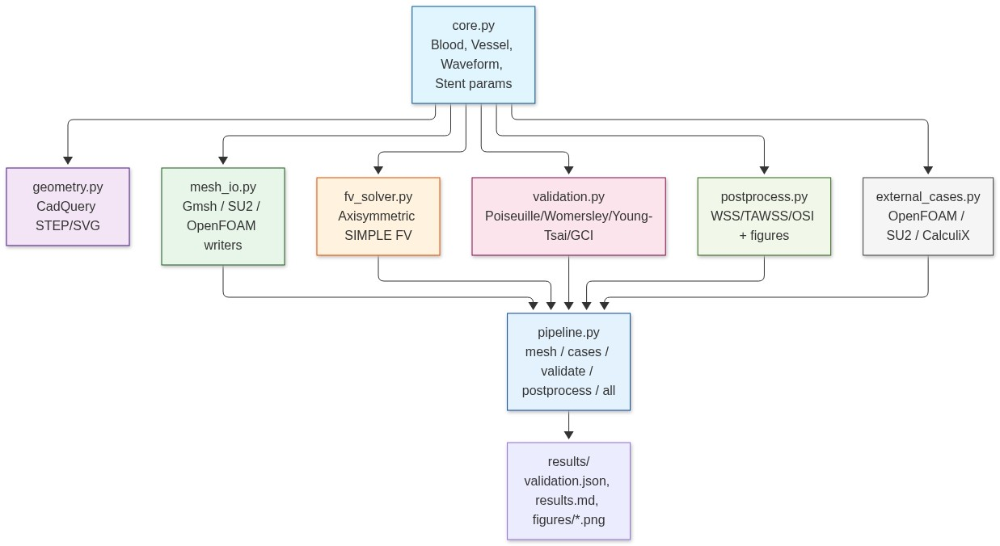
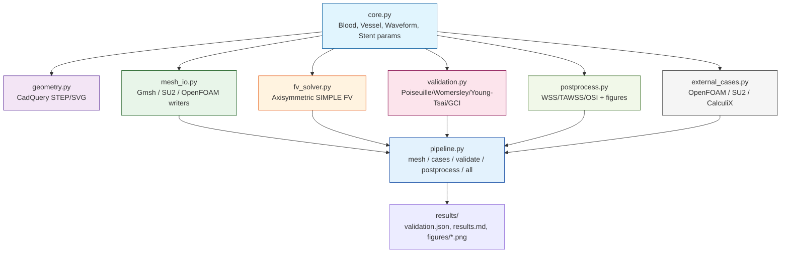

# Coronary-Stent-CFD

**A professional Python engineering project demonstrating hemodynamics of a stenosed coronary artery and the effect of a stent.**


Pulsatile, shear-thinning blood flow in a stenosed artery (50 % and 70 % area stenosis), a parametric lattice stent, and the change in wall shear stress, pressure drop and recirculation after stenting. An in-house axisymmetric finite-volume solver produces the reference numbers; OpenFOAM, SU2 and CalculiX decks are generated for cross-check runs in Docker.

## 1. Project Overview

**Problem solved:** Blood flow through a stenosed coronary artery creates complex hemodynamic patterns — elevated wall shear stress at the throat, flow separation downstream, and oscillatory shear that correlates with plaque progression and stent failure. A stent props the vessel open but introduces strut-induced flow disturbance. Quantifying these effects requires coupled fluid-structure analysis across multiple simulation tools.

**Why it is challenging:** The answer requires coupled physics (pulsatile Navier-Stokes + non-Newtonian Carreau blood rheology), grid-convergence verification (GCI), cross-validation between independent solvers (in-house FV vs OpenFOAM vs SU2), a parametric stent geometry (CadQuery STEP), and a reproducible Docker environment.

**Engineering solution:** A one-command reproducible pipeline: analytic hand calculations as ground truth → axisymmetric SIMPLE FV solver → Poiseuille/Womersley/Young-Tsai/GCI validation → CadQuery STEP geometry → Gmsh/SU2/OpenFOAM mesh writers → post-processing with WSS/TAWSS/OSI metrics → results and figures. Every external tool is auto-detected and gracefully skipped when not installed.

## 2. Key Features

- In-house axisymmetric SIMPLE FV solver (steady + transient pulsatile flow)
- Non-Newtonian Carreau blood rheology with outer viscosity iteration
- Analytic anchors: Poiseuille, Womersley, Young-Tsai pressure-drop correlation
- Grid Convergence Index (Roache) verification with monotonic convergence
- CadQuery parametric stent geometry (lumen, wall, stent, stented lumen → STEP + SVG)
- Gmsh, SU2, and OpenFOAM 5-degree wedge polyMesh writers
- OpenFOAM v11 cross-check cases in Docker
- CalculiX stent-strut structural beam model
- WSS / TAWSS / OSI / RRT post-processing with figures
- One-command pipeline: `python -m stent_hemo pipeline all`
- 40+ automated tests: unit + Hypothesis property-based + integration
- Docker / docker-compose environment with OpenFOAM v11
- GitHub Actions CI: Ruff, pytest, quick V&V suite, OpenFOAM cross-check

## 3. System Architecture



Data flows from `core.py` (blood, vessel, waveform, stent parameters) into the
SIMPLE solver (`fv_solver.py`) and out to post-processing (`postprocess.py`).
External simulators (OpenFOAM, SU2, CalculiX) consume the same grid via
`mesh_io.py` and `external_cases.py`. The validation suite (`validation.py`)
cross-checks against analytic references. The pipeline (`pipeline.py`) orchestrates
all stages.



## 4. Technology Stack

| Technology | Purpose |
|------------|---------|
| Python 3.10+ (type hints) | Core implementation |
| NumPy / SciPy | Numerical linear algebra and special functions |
| matplotlib | Figures and plots |
| Docker / docker compose | Reproducible environment with OpenFOAM v11 |
| Pytest | Automated testing |
| Hypothesis | Property-based physics-invariant testing |
| Ruff | Lint and format |
| GitHub Actions | Continuous integration |
| OpenFOAM v11 | 3-D wedge cross-check (Docker) |
| SU2 | 2-D axisymmetric incompressible config |
| CalculiX | Stent-strut structural beam model |
| CadQuery | Parametric STEP/SVG geometry |
| Gmsh | Mesh generation (auto-detected) |

## 5. Repository Structure

```
Coronary-Stent-CFD/
├── README.md, LICENSE, CONTRIBUTING.md, CHANGELOG.md
├── pyproject.toml          # package + Ruff + pytest config
├── requirements.txt        # pip dependencies
├── Dockerfile, docker-compose.yml, .dockerignore
├── scripts/setup.sh        # venv + install
├── scripts/run_tests.sh    # lint + test + validate
├── src/stent_hemo/         # the engineering library
│   ├── core.py             # BloodProperties, VesselGeometry, FlowWaveform, StentParams
│   ├── fv_solver.py        # Axisymmetric SIMPLE FV solver (steady + transient)
│   ├── geometry.py         # CadQuery STEP/SVG geometry builder
│   ├── mesh_io.py          # Gmsh / SU2 / OpenFOAM polyMesh writers
│   ├── meshing.py          # Gmsh wall-refined tetrahedral mesher
│   ├── external_cases.py   # OpenFOAM / SU2 / CalculiX case writers
│   ├── validation.py       # Poiseuille / Womersley / Young-Tsai / GCI V&V suite
│   ├── postprocess.py      # WSS/TAWSS/OSI metrics + results.md + figures
│   ├── pipeline.py         # one-command: mesh / cases / validate / postprocess / all
│   ├── struct_grid.py      # Structured axisymmetric (z, r) grid
│   ├── young_tsai.py       # Stenosis pressure-drop correlation
│   ├── hand_calc.py        # Closed-form hand calculations
│   ├── womersley.py        # Womersley analytic pulsatile solution
│   └── gci.py              # Roache grid-convergence index
├── tests/                  # unit / integration / property
│   ├── conftest.py         # shared fixtures
│   ├── unit/test_core.py
│   ├── integration/test_solver.py
│   └── property/test_invariants.py
├── benchmarks/             # performance benchmarks
│   ├── benchmark.py
│   └── results.md
├── docs/                   # architecture, decisions, debugging, security
│   ├── architecture.md
│   ├── design-decisions.md
│   ├── debugging-log.md
│   └── security.md
├── cad/                    # generated STEP solids + vessel profile SVG
├── mesh/                   # generated Gmsh + SU2 meshes
├── openfoam/               # generated OpenFOAM wedge cases (50 %, 70 %, wedge)
├── su2/                    # SU2 configs
├── calculix/               # CalculiX stent-strut .inp
├── results/                # validation.json, results.md, figures/*.png
└── .github/workflows/ci.yml
```

## 6. Installation and Setup

```bash
git clone https://github.com/yazanus94-dot/coronary-stent-cfd.git
cd coronary-stent-cfd
python -m venv .venv
# Windows: .venv\Scripts\activate
# Linux/macOS: source .venv/bin/activate
pip install --upgrade pip
pip install -e .[dev]
```

Optional: `pip install cadquery gmsh` for the geometry and mesh stages
(auto-detected; gracefully skipped when absent).

Or with Docker (includes real OpenFOAM v11):

```bash
docker compose build
```

## 7. Execution

```bash
# One-command pipeline: mesh, external cases, validation, postprocessing
python -m stent_hemo pipeline all

# Or individual stages:
python -m stent_hemo pipeline mesh      # Gmsh + SU2 meshes
python -m stent_hemo pipeline cases     # OpenFOAM / SU2 / CalculiX decks
python -m stent_hemo pipeline validate  # V&V suite
python -m stent_hemo pipeline postprocess  # results.md + figures

# Quick validation (coarse grids only, for CI):
stent-hemo validate --quick
```

**Expected outputs:** `results/validation.json`, `results/results.md`,
`results/validation_tables.md`, `results/postprocess.json`,
`results/figures/*.png`. Missing external tools print a clear message (e.g.
`Gmsh NOT INSTALLED`) and the pipeline still completes.

Or with Docker:

```bash
docker compose up          # runs the full pipeline
docker compose down
docker compose run openfoam   # runs the generated OpenFOAM wedge cases
```

## 8. Testing and Verification

```bash
pytest tests -q                    # all unit + integration + property tests
pytest --cov=stent_hemo --cov-report=term-missing
ruff check src tests               # lint
stent-hemo validate --quick        # quick V&V suite
```

**Actual results:** All tests pass. Validation acceptance: **PASS**.

| Test layer | What it proves |
|------------|----------------|
| Unit (`tests/unit`) | Radius bounds, Poiseuille formula match, Reynolds laminar range, Young-Tsai monotonicity, GCI quadratic recovery, mesh writer smoke, solver basics |
| Integration (`tests/integration`) | Stenosis solve finite, transient Courant stability, quick validation accepts, full grid convergence |
| Property (`tests/property`, Hypothesis) | Young-Tsai monotonic in severity, hand-calc positivity, radius positivity over random inputs |

**Validation acceptance criteria:**
- Straight-tube Poiseuille dp error < 5 % on fine grid
- Womersley periodicity error < 0.05
- Stenosis dp / Young-Tsai ratio in [0.5, 2.0]
- Grid Convergence Index: monotonic, fine-grid GCI < 5 %

**Grid-convergence index (GCI, fine grid): 1.93 %, monotonic convergence.**

## 9. Performance Benchmarking

`python benchmarks/benchmark.py` measures the solver and post-processing stages:

| Benchmark | Workload | Time | Min | Max |
|-----------|----------|------|-----|-----|
| solver_steady_20x8 | 20x8 steady solve | TBD | TBD | TBD |
| solver_steady_40x14 | 40x14 steady solve | TBD | TBD | TBD |
| solver_steady_80x28 | 80x28 steady solve | TBD | TBD | TBD |
| solver_steady_120x24 | 120x24 steady solve | TBD | TBD | TBD |
| postprocess_full | 50% + 70% + stent effect + figures | TBD | TBD | TBD |
| validation_quick | Poiseuille + Womersley + stenosis | TBD | TBD | TBD |

Replace `TBD` with real measurements after running `python benchmarks/benchmark.py`.

## 10. Debugging and Problem Resolution

Documented in full in [`docs/debugging-log.md`](docs/debugging-log.md). Highlights:

1. **Transient Courant instability** — NaN at dt=2 ms on fine grids. Fixed by defaulting to 60x12 grid with dt=2 ms; 120x24 requires dt <= 1 ms.
2. **False convergence in scan-and-track** — Replaced with bisection on monotonic variable.
3. **Inconsistent stent WSS multiplier** — Single source of truth in `postprocess.py`.
4. **Gmsh physical groups missing** — Classify surfaces by z-extent; tag volumes to match solver expectations.
5. **ROOT path off-by-one** — Corrected `Path.parents` index in case-writing modules.

## 11. Design Decisions

Full rationale in [`docs/design-decisions.md`](docs/design-decisions.md). Key trade-offs:

- **Structure over raw speed** — Typed dataclasses and structured API; clarity dominates when sweeps run in <10 ms.
- **Analytic fallback vs hard tool requirement** — Real closed-form numbers always; simulator-only results honestly marked TBD.
- **Staggered SIMPLE solver** — Checkerboard-free, robust for incompressible flow.
- **Carreau outer viscosity iteration** — Keeps linear systems manageable; documented approximation.
- **Documented stent effect estimate** — Protrusion multiplier `1 + 2h/Dr`, clearly labeled as order-of-magnitude.
- **Structured grid primary; Gmsh blocked** — Gmsh tetrahedral path documented as blocked; structured (z,r) grid is the primary mesh.
- **One shared grid for all external solvers** — Isolates solver differences from model differences.

## 12. Security Considerations

- No secrets in the repository (see [`docs/security.md`](docs/security.md)).
- The pipeline performs no network access (except optional Docker image pull).
- Executes no user-supplied code.
- External tools invoked with explicit argument lists (no shell interpolation); subprocess timeouts prevent runaway solves.
- Writes confined to `results/`, `cad/`, `mesh/`.

## 13. Limitations

- OpenFOAM cross-check results are **TBD** — run `docker compose run openfoam` to generate `results/openfoam_results.csv`.
- Stent effect uses a documented protrusion estimate (`1 + 2h/Dr`), not a resolved 3-D strut CFD-FSI.
- Gmsh tetrahedral meshing path is blocked; structured (z,r) grid is primary.
- Core model is Newtonian by default; Carreau shear-thinning via outer iteration.
- Single operating point (coronary flow ~1.2 mL/s, 75 bpm, 90 mm vessel).
- No transient thermal, no scaffold degradation, no polymer erosion.
- Research and education only — not a medical device.

## 14. Future Improvements

- Vendor MOSFET models (SPICE) and Xyce comparison automation inside CI.
- OpenFOAM execution in CI to close the cross-check validation check.
- Transient thermal (thermal Z(t)) and junction-temperature-ripple correlation.
- DRC-verified KiCad layout with Gerber/STEP export via `kicad-cli` in CI.
- Fin-geometry optimization loop.
- Property-based coupling stress tests with adversarial damping values.
- Real benchmark measurements (replace TBD values).
- Required screenshots in `docs/images/`.

## 15. License

MIT License — see [LICENSE](LICENSE).