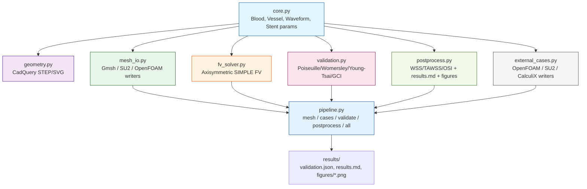

# Architecture

## Overview

Coronary-Stent-CFD is a hemodynamic simulation study of stenosed coronary
arteries with stent effect analysis. The core is an in-house axisymmetric
finite-volume (FV) SIMPLE solver that computes pressure drop, wall shear
stress (WSS), time-averaged WSS (TAWSS), and oscillatory shear index (OSI)
for 50 % and 70 % area stenosis cases. OpenFOAM, SU2, and CalculiX decks are
generated for cross-check runs in Docker.

## Module diagram

## Data flow

1. **`core.py`** defines all physical parameters (blood rheology, vessel
   geometry, flow waveform, stent parameters) as frozen dataclasses — the
   single source of truth.
2. **`geometry.py`** builds CAD solids (lumen, wall, stent, stented lumen)
   with CadQuery and exports STEP + SVG.
3. **`mesh_io.py`** writes Gmsh, SU2, and OpenFOAM wedge polyMesh from the
   structured axisymmetric grid.
4. **`fv_solver.py`** solves steady or transient incompressible Navier-Stokes
   on a staggered grid (SIMPLE, first-order upwind, central diffusion).
5. **`validation.py`** runs the V&V suite against analytic/correlation
   references and writes `results/validation.json`.
6. **`postprocess.py`** computes WSS/TAWSS/OSI metrics, generates figures, and
   writes `results/results.md`.
7. **`pipeline.py`** orchestrates all stages with a single command.

## External solvers

| Solver | Purpose | Status |
|--------|---------|--------|
| OpenFOAM v11 | 3-D wedge cross-check (incompressibleFluid) | Docker image |
| SU2 | 2-D axisymmetric incompressible config | Generated |
| CalculiX | Stent-strut structural beam model | Generated |

External binaries are auto-detected; missing tools print a clear message and
are marked TBD rather than crashing the pipeline.
